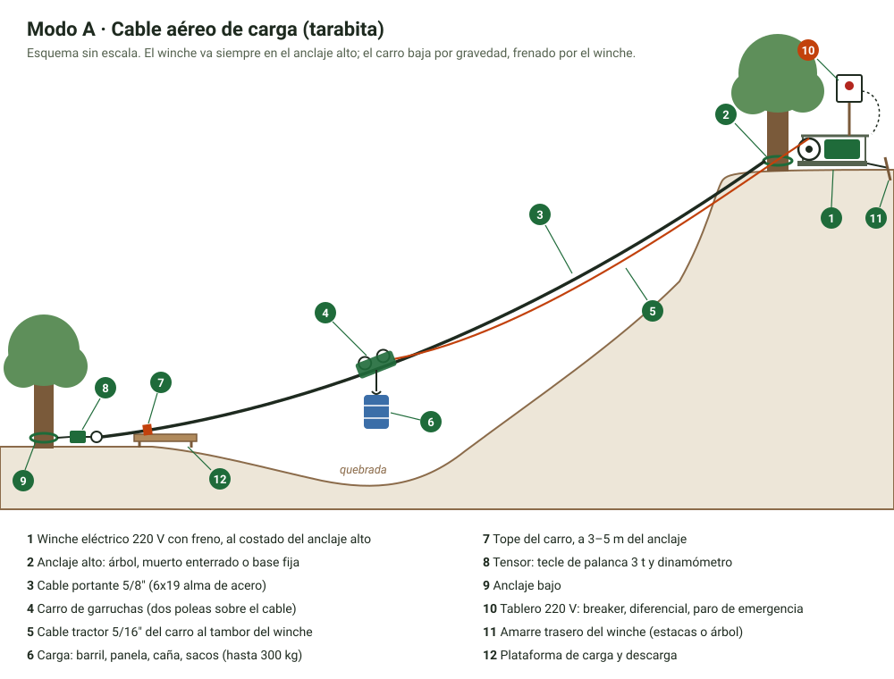
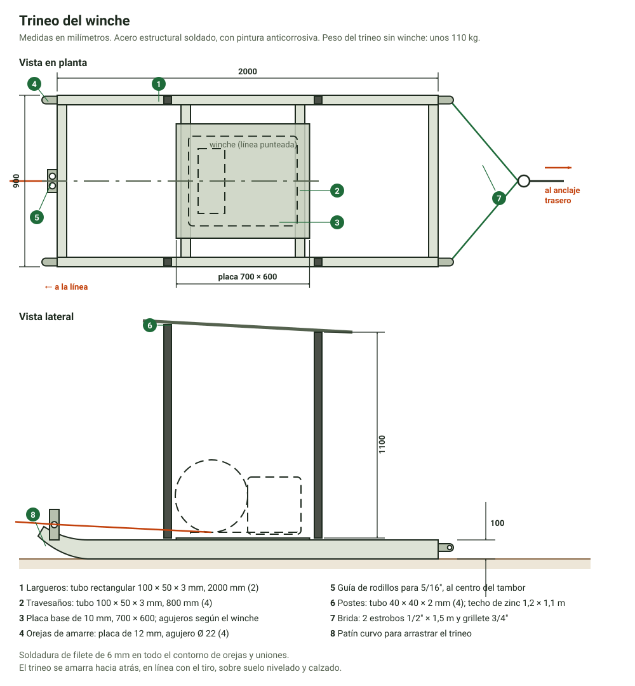
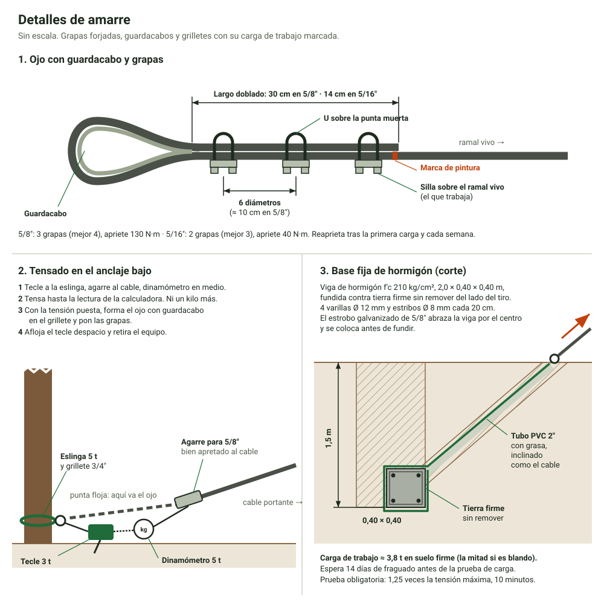
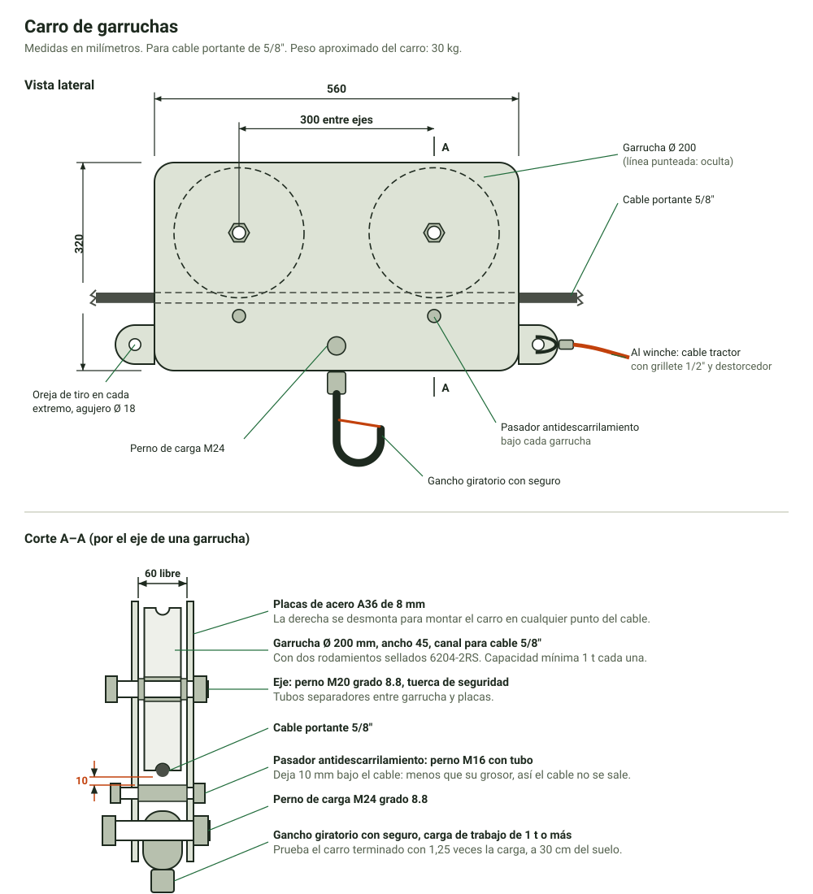
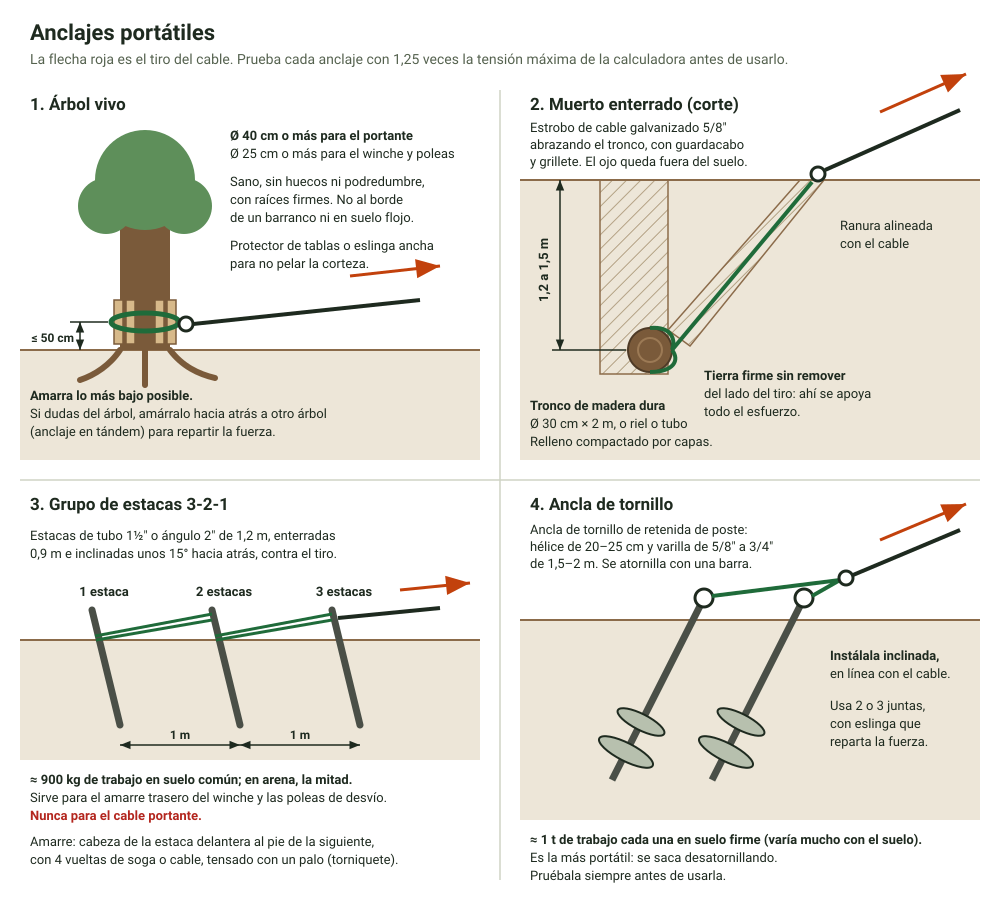
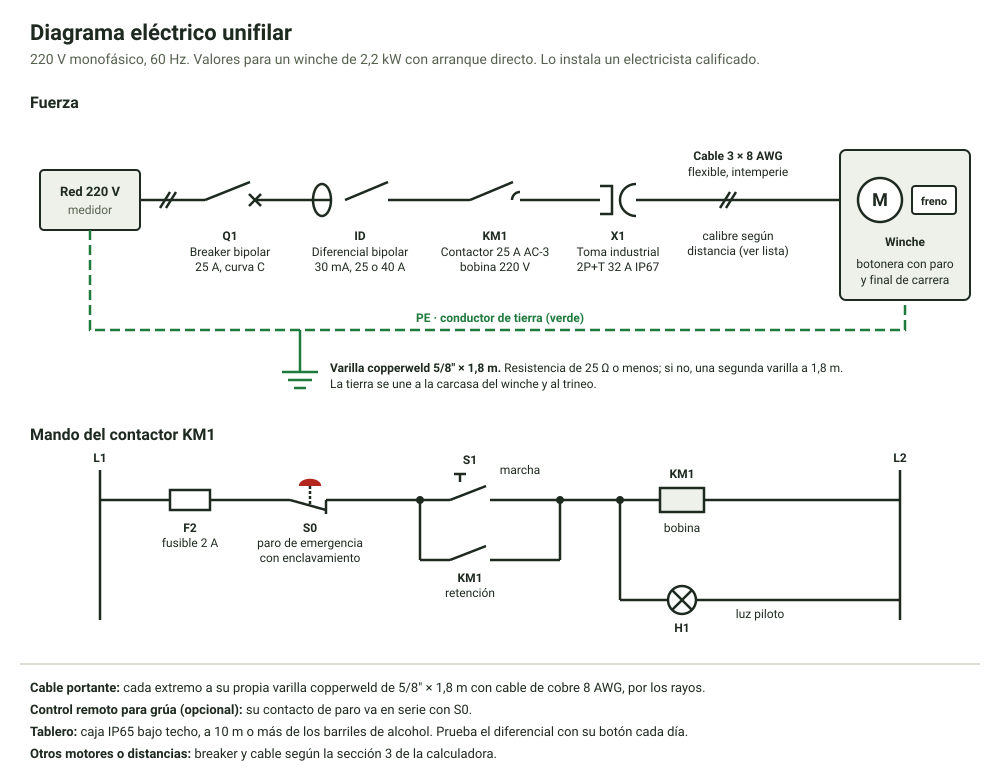
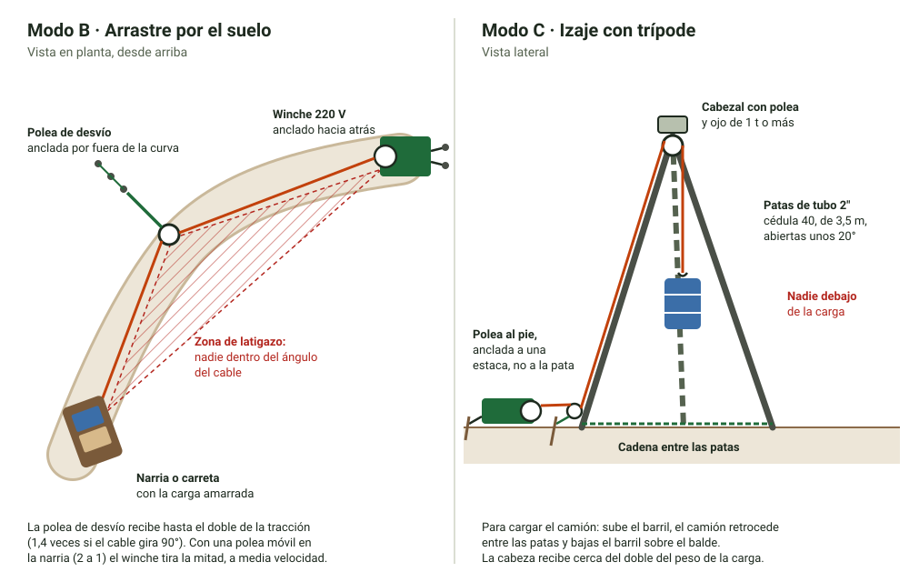

# Sistema portátil de transporte de carga por cable para finca cañera

Diseño de un sistema para mover caña, panela, barriles de alcohol y cualquier carga pesada dentro de la finca. Usa un winche con motor eléctrico de 220 V, poleas, un carro de garruchas y anclajes portátiles, así que se puede armar en distintos puntos de la finca.

**Contenido de esta carpeta**

| Archivo | Para qué sirve |
| --- | --- |
| `README.md` | Este documento: diseño, cálculos, materiales, instalación, operación y mantenimiento. |
| [`planos-y-materiales.pdf`](planos-y-materiales.pdf) | **Paquete para el ingeniero**: portada, criterios de diseño, láminas L2 a L8, lista de materiales y pruebas de entrega para firmar. 14 hojas A4 horizontales para imprimir. |
| [`lista-de-materiales.xlsx`](lista-de-materiales.xlsx) | Lista de materiales para cotizar y comprar: 78 ítems, con columnas para proveedor, precio y si ya se compró. Suma sola los totales por grupo. |
| [`calculadora.html`](calculadora.html) | Calculadora para cada sitio: tensión del cable, factor de seguridad, anclajes, tensado, motor y cable eléctrico. Ábrela en el navegador del celular; funciona sin internet. |
| [`img/esquema-general.svg`](img/esquema-general.svg) | Esquema del cable aéreo. |
| [`img/carro-garruchas.svg`](img/carro-garruchas.svg) | Plano del carro de garruchas para el taller. |
| [`img/anclajes.svg`](img/anclajes.svg) | Los cuatro anclajes portátiles. |
| [`img/arrastre-e-izaje.svg`](img/arrastre-e-izaje.svg) | Arrastre por el suelo e izaje con trípode. |
| [`img/trineo-winche.svg`](img/trineo-winche.svg) | Plano del trineo del winche para el taller. |
| [`img/detalles-amarre.svg`](img/detalles-amarre.svg) | Ojo con grapas, tensado en el anclaje bajo y base fija de hormigón. |
| [`img/diagrama-electrico.svg`](img/diagrama-electrico.svg) | Diagrama eléctrico unifilar del tablero y el winche. |

> **Antes de construir.** Este es un diseño preliminar. Un ingeniero mecánico o civil debe revisarlo y aprobar cada línea en su sitio. Cada anclaje debe pasar la prueba de carga antes del primer viaje. **El sistema es solo para carga. Nunca transporta personas.**

---

## 1. Cómo funciona

Es un solo juego de equipos (el *kit*) que se arma de tres formas:

| Modo | Para qué | Distancia |
| --- | --- | --- |
| **A. Cable aéreo** (tarabita de carga) | Bajar o subir carga por laderas y cruzar quebradas. El carro rueda colgado de un cable tendido entre dos anclajes. | 30 a 300 m |
| **B. Arrastre por el suelo** | Subir o bajar una carreta o una narria por un camino o una rampa. | Lo que dé el cable del winche |
| **C. Izaje con trípode** | Subir barriles a un camión, a una plataforma o al trapiche. | Vertical, hasta unos 3 m |

En el modo A, el **winche va siempre en el extremo alto** de la línea. Para subir carga, el winche jala el carro. Para bajarla, el winche suelta cable con el motor y el freno controla la bajada. Así el carro vacío regresa por su peso, sin un segundo cable.

## 2. Datos de diseño

| Dato | Valor |
| --- | --- |
| Carga útil máxima por viaje | **300 kg** |
| Carro, gancho y canasta | 50 kg |
| Factor dinámico (arranques, frenadas, rebote) | 1,2 sobre la carga |
| Tracción del winche | 500 kg |
| Velocidad del cable | 15 a 20 m/min |
| Electricidad | 220 V monofásico, 60 Hz |
| Línea aérea | 30 a 300 m de distancia horizontal, pendiente de 20 % a 100 % |
| Factor de seguridad del cable | 4 o más, con el 80 % de la resistencia (por las grapas) y la carga con factor dinámico. Equivale a 6 sobre la carga quieta y la resistencia nominal. |
| Anclajes | Resistencia de rotura de 2 veces la tensión máxima o más, y prueba de carga antes de usar |

### Cuánto pesa lo que vas a mover

| Carga | Peso aproximado | Por viaje |
| --- | --- | --- |
| Barril de 55 galones (208 L) de aguardiente, lleno | 210 a 220 kg (barril incluido) | 1 |
| Quintal de panela (100 lb) | 46 kg | hasta 6 |
| Saco de abono | 50 kg | hasta 6 |
| Atado de caña | 40 a 60 kg | 5 o 6, pesándolos |

El barril sale de 208 L × 0,95 kg/L ≈ 198 kg de aguardiente de 30 a 50 % de alcohol, más 10 a 20 kg del barril. Aun así, **pesa tus cargas reales con el dinamómetro** (una balanza colgante digital). Es la herramienta más importante del kit: sirve para pesar la carga, para tensar el cable y para probar los anclajes.

## 3. Componentes

### 3.1 Winche (unidad motriz)

**Opción recomendada: winche eléctrico de tambor comercial** (malacate de obra). Es más seguro que uno hecho en taller porque el freno y los controles vienen probados de fábrica. Al comprarlo, exige:

- Tracción de **500 kg o más** en la capa de cable con la que va a trabajar.
- Tambor con capacidad para **todo el cable tractor** de 5/16" (sección 3.3). Para una línea de 200 m, unos 230 m.
- **Freno electromagnético de resorte**: frena solo cuando se corta la corriente. Un reductor de sinfín que «no se devuelve» no cuenta como freno.
- **220 V monofásico, 60 Hz.** En Ecuador la red es de 60 Hz; muchos winches importados son de 50 Hz y con 60 Hz pierden fuerza.
- Unos 2,2 kW (3 HP). Con eso alcanzan los tres modos.
- Botonera de pulsadores que solo mueven mientras se mantienen apretados, con **paro de emergencia**.
- Protección IP54 o mejor (polvo y lluvia) y servicio intermitente de 25 % o más (S3).

Los polipastos pequeños de 12 a 20 m de cable sirven para el trípode (modo C), pero no para la línea aérea.

**Opción fabricada en taller.** Solo con un taller metalmecánico serio y la revisión de un ingeniero:

| Parte | Especificación |
| --- | --- |
| Motor | Trifásico 2,2 kW, 4 polos (1750 rpm a 60 Hz), **con freno de disco de resorte** |
| Variador de frecuencia | 2,2 kW, entrada monofásica 220 V, salida trifásica 220 V, con resistencia de frenado y salida de relé para el freno (configuración de izaje) |
| Reductor | Helicoidal, relación 1:80, par de salida de 1200 N·m o más |
| Tambor | Ø 200 mm, 300 mm de ancho, pestañas de Ø 380 mm, sobre chumaceras. Lleva unos 240 m de cable de 5/16" en 8 capas |

Cálculo: en la capa exterior (radio 0,16 m) el par para 500 kg es 500 × 9,81 × 0,16 = 785 N·m. Con un factor de servicio de 1,5 da 1180 N·m. A 18 m/min en la capa media (Ø 264 mm) el tambor gira a 22 rpm, y 1750 ÷ 22 ≈ 80. La potencia en la capa exterior es 4905 N × 0,37 m/s ÷ 0,9 de eficiencia del reductor ≈ 2,0 kW, por eso el motor de 2,2 kW.

**Base (trineo).** El winche va atornillado sobre un trineo de tubo estructural de 100 × 50 × 3 mm, de unos 2,0 × 0,9 m, con:

- Patines curvos adelante para arrastrarlo. En terreno suave, el winche se mueve solo: ancla el cable adelante y que se jale a sí mismo.
- Cuatro orejas de amarre de placa de 12 mm con agujero de 22 mm.
- Techo de zinc para el motor y el tablero.

El plano para el taller está en [`img/trineo-winche.svg`](img/trineo-winche.svg).

El trineo se amarra **hacia atrás**, en línea con el tiro, a un árbol o a dos grupos de estacas 3-2-1. Deja al menos 6 m rectos entre el tambor y la primera polea, con el cable llegando al centro del tambor, para que el cable se enrolle parejo.

### 3.2 Cable portante

**Cable de acero 5/8" (16 mm), 6x19 con alma de acero, galvanizado, con resistencia de ruptura de 16 t o más.**

Se eligió de 5/8" porque da un factor de seguridad de 4 o más en casi todos los sitios, aunque lo tensen un poco de más o se corroa con los años. El cable de 1/2" queda justo: en una línea de 150 m con 33 % de pendiente y 6 % de flecha da un factor de 4,0, sin margen.

**La flecha manda.** La flecha es cuánto baja el cable con la carga en el centro, medida desde la línea recta entre los anclajes. Más flecha da menos tensión en el cable y en los anclajes. Pero si la línea es poco inclinada y le das mucha flecha, el cable hace un punto bajo antes del anclaje bajo y el carro se queda ahí. Regla práctica:

| Pendiente de la línea (desnivel ÷ distancia) | Flecha con carga |
| --- | --- |
| 35 % o más | 8 % |
| 20 % a 35 % | 6 % |
| Menos de 20 % | El carro vacío no regresa solo. Usa el modo B, o una línea con cable de retorno (no está en este diseño). |

**Resultados para el cable de 5/8"** (300 kg de carga, 50 kg de carro):

| Distancia | Desnivel | Flecha | Tensa en vacío hasta | Flecha en vacío | Tensión máxima | Factor de seguridad | Cada anclaje resiste | Tracción del winche | Carro vacío baja |
| --- | --- | --- | --- | --- | --- | --- | --- | --- | --- |
| 100 m | 25 m (25 %) | 6 % | 275 kg | 4,6 m | 2059 kg | 6,3 | 4118 kg | 237 kg | hasta 4 m de A |
| 150 m | 50 m (33 %) | 6 % | 421 kg | 6,8 m | 2236 kg | 5,8 | 4472 kg | 261 kg | hasta A |
| 200 m | 50 m (25 %) | 6 % | 544 kg | 9,3 m | 2287 kg | 5,7 | 4574 kg | 243 kg | hasta A |
| 300 m | 75 m (25 %) | 6 % | 805 kg | 14,2 m | 2515 kg | 5,2 | 5030 kg | 241 kg | hasta A |
| 100 m | 50 m (50 %) | 8 % | 202 kg | 6,4 m | 1754 kg | 7,4 | 3507 kg | 314 kg | hasta A |
| 150 m | 75 m (50 %) | 8 % | 302 kg | 9,7 m | 1853 kg | 7,0 | 3707 kg | 318 kg | hasta A |
| 200 m | 140 m (70 %) | 8 % | 446 kg | 12,4 m | 2141 kg | 6,1 | 4281 kg | 341 kg | hasta A |
| 300 m | 150 m (50 %) | 8 % | 594 kg | 19,7 m | 2152 kg | 6,0 | 4305 kg | 318 kg | hasta A |
| 250 m | 250 m (100 %) | 8 % | 730 kg | 13,7 m | 2580 kg | 5,0 | 5160 kg | 361 kg | hasta A |

Para tu sitio, usa la [calculadora](calculadora.html). Lo más importante que te da es **la lectura del dinamómetro al tensar el cable vacío**: tensar por encima de esa lectura reduce la flecha y sube la tensión con carga.

**Amarres del cable.** Cada extremo lleva guardacabo y grapas forjadas (no de fundición). La silla de la grapa va sobre el ramal que trabaja y la U sobre la punta suelta. Vuelve a apretarlas después de la primera carga y cada semana. Pinta una marca en el cable junto a la última grapa: si la marca se corre, el cable está resbalando.

| Cable | Grapas | Largo doblado | Apriete |
| --- | --- | --- | --- |
| 5/8" (portante) | 3, mejor 4 | 30 cm | 130 N·m (95 lb·pie) |
| 5/16" (tractor) | 2, mejor 3 | 14 cm | 40 N·m (30 lb·pie) |

**Tensado.** En el anclaje bajo, entre el cable y el anclaje, van el tecle de palanca de 3 t, el dinamómetro y un agarre de cable para 5/8". Tensa hasta la lectura de la tabla. Luego cierra el ojo con guardacabo y grapas, y retira el tecle.

### 3.3 Cable tractor

Cable de acero 5/16" (8 mm), 6x19 con alma de acero, galvanizado, con resistencia de ruptura de 4 t o más. Su largo es el de la línea, medida a lo largo del cable, más 5 % y 15 m: para 200 m, unos 230 m. Deja **siempre 3 vueltas o más en el tambor** con el carro en el punto más lejano. Al carro se une con un **destorcedor** de 1 t para que no se tuerza y un grillete de 1/2".

Con tinta o pintura, marca el cable tractor a 10 m y a 3 m de cada extremo del recorrido. Así el operador sabe cuándo bajar la velocidad.

### 3.4 Carro de garruchas

| Pieza | Cantidad | Especificación |
| --- | --- | --- |
| Placas laterales | 2 | Acero A36 de 8 mm, 560 × 320 mm, con orejas de tiro en ambos extremos (agujero Ø 18). Una se desmonta para montar el carro en el cable. |
| Garruchas | 2 | Ø 200 mm, 45 mm de ancho, canal para cable de 5/8", dos rodamientos sellados 6204-2RS cada una, capacidad de 1 t o más |
| Ejes | 2 | Pernos M20 grado 8.8 con tuerca de seguridad y tubos separadores. 300 mm entre ejes. |
| Pasadores antidescarrilamiento | 2 | Pernos M16 con tubo, 10 mm debajo del cable |
| Perno de carga | 1 | M24 grado 8.8, al centro y abajo |
| Gancho giratorio con seguro | 1 | Carga de trabajo de 1 t o más |

Peso aproximado: 30 kg. Antes de usarlo, cuelga del carro **1,25 veces la carga** (440 kg con la canasta) a 30 cm del suelo durante 10 minutos y revisa que nada se deforme.

### 3.5 Accesorios para colgar la carga

- **Barriles.** Van en una canasta o cuna metálica con eslinga de 4 ramales, siempre parados y con el tapón arriba. Si el barril es metálico y tiene ceja, puedes usar una pinza para tambor de 500 kg. Nunca cuelgues un barril de la tapa ni de una sola ceja.
- **Panela y sacos.** Saco grande (big bag) de 1 t con 4 asas, o canasta de malla.
- **Caña.** Dos eslingas de poliéster en ahorcado, separadas 1 m, para que las cañas no se resbalen. También sirve una cuna larga de tubo.
- **Eslingas y grilletes** de 1 t de carga de trabajo o más, con su etiqueta legible.

### 3.6 Anclajes portátiles

| Anclaje | Carga de trabajo aproximada | Uso |
| --- | --- | --- |
| Árbol vivo y sano de Ø 40 cm o más, amarrado a menos de 50 cm del suelo | hasta 3 t | Cable portante, winche, poleas |
| Árbol vivo y sano de Ø 25 a 40 cm | hasta 1 t | Winche y poleas |
| Muerto enterrado: tronco de Ø 30 cm × 2 m a 1,5 m de profundidad, en suelo firme | 3,8 t (a 1,2 m: 2,4 t) | Cable portante |
| Base fija: viga de hormigón de 2,0 × 0,4 × 0,4 m enterrada a 1,5 m, con estrobo galvanizado | 3,8 t | Puntos que se usan cada zafra |
| 2 o 3 anclas de tornillo juntas | 1 t cada una | Winche y poleas; el portante solo con 3 y prueba |
| Grupo de estacas 3-2-1 | 0,9 t | Amarre trasero del winche y poleas de desvío. **Nunca para el portante.** |

La carga de trabajo es la mitad de la resistencia de rotura estimada. El valor del muerto sale del empuje pasivo de Rankine para suelo firme (ángulo de fricción de 25°, peso de 16 kN/m³): 37 kN por metro de tronco a 1,5 m de profundidad. En suelo blando o empapado, cuenta la mitad. La cifra de las estacas es la de los manuales de aparejos del ejército de EE. UU. (1800 kg de rotura en suelo común); en arena, la mitad. Estas cifras son orientativas: **la prueba de carga es la que decide**.

**Puntos fijos.** En los sitios que se usan cada zafra (trapiche, carretera, cabecera de cada lote) conviene enterrar una base fija de hormigón con su estrobo. Después, el winche y el cable se mueven entre bases.

**Prueba de carga de cada anclaje.** Con el tecle y el dinamómetro, jala el anclaje en la misma dirección en que lo jalará el cable, contra otro anclaje, hasta **1,25 veces la tensión máxima** que da la calculadora. Mantén la fuerza 10 minutos. Si el anclaje se mueve más de 2 cm o el árbol cruje, no sirve.

### 3.7 Tablero eléctrico y control

Lo debe instalar un electricista calificado.

- Caja de intemperie IP65 con breaker bipolar, **interruptor diferencial de 30 mA**, paro de emergencia de enclavamiento y luz piloto.
- Tomacorriente industrial de 220 V para conectar el winche.
- **Puesta a tierra**: varilla copperweld de 5/8" × 1,8 m, unida a la carcasa del winche y al trineo.
- Conecta también **cada extremo del cable portante a una varilla de tierra**, por los rayos.
- Botonera con paro de emergencia. Mejor aún: un **control remoto industrial para grúa** con paro de emergencia, para que el operador pueda caminar junto a la carga.
- Si el winche no lo trae, un **final de carrera** que corte el motor cuando el carro llegue al tope alto.

**Cable eléctrico** (de cobre, 3 conductores: dos fases y tierra, flexible para intemperie). Valores para un motor de 2,2 kW con arranque directo:

| Distancia tablero–winche | Cable | Breaker |
| --- | --- | --- |
| hasta 39 m | 10 AWG (5,3 mm²) | 25 A, curva C |
| 40 a 62 m | 8 AWG (8,4 mm²) | 25 A, curva C |
| 63 a 99 m | 6 AWG (13,3 mm²) | 25 A, curva C |
| 100 a 158 m | 4 AWG (21,2 mm²) | 25 A, curva C |

Para otros motores y distancias, usa la sección 3 de la calculadora. Si no hay red en el sitio, un generador de 220 V de **7 kVA o más** arranca el motor de 2,2 kW en directo; con variador de frecuencia basta uno de 4,5 kVA.

## 4. Lista de materiales del kit (línea de hasta 200 m a lo largo del cable)

Esta es la lista resumida. La lista completa, con 78 ítems, especificación mínima, lámina y nota de compra, está en [`planos-y-materiales.pdf`](planos-y-materiales.pdf) (lámina L9) y en [`lista-de-materiales.xlsx`](lista-de-materiales.xlsx) para cotizar.

| # | Material | Cantidad |
| --- | --- | --- |
| 1 | Winche eléctrico de tambor, 500 kg, 220 V 60 Hz, con freno electromagnético y capacidad para 230 m de cable de 5/16" | 1 |
| 2 | Cable de acero 5/8" 6x19 alma de acero galvanizado, ruptura de 16 t o más | 220 m (largo de la línea + 12 m) |
| 3 | Cable de acero 5/16" 6x19 alma de acero galvanizado, ruptura de 4 t o más | 230 m (largo de la línea + 5 % + 15 m) |
| 4 | Carro de garruchas (plano en 3.4) | 1 |
| 5 | Tecle de palanca de 3 t | 1 |
| 6 | Agarre de cable para 5/8", 3 t | 1 |
| 7 | Dinamómetro o balanza colgante digital de 5 t | 1 |
| 8 | Grapas forjadas para cable de 5/8" | 12 |
| 9 | Grapas forjadas para cable de 5/16" | 8 |
| 10 | Guardacabos de 5/8" y de 5/16" | 4 de cada uno |
| 11 | Grilletes de 3/4" (4,75 t) para los anclajes del portante | 4 |
| 12 | Grilletes de 1/2" (2 t) | 6 |
| 13 | Eslingas redondas de poliéster de 5 t, 4 m, para árboles, con protector de corteza | 2 |
| 14 | Estrobos de cable galvanizado de 5/8" × 4 m con ojos y guardacabos, para muertos | 2 |
| 15 | Destorcedor con rodamiento, 1 t | 1 |
| 16 | Poleas de desvío (pastecas de apertura lateral) para 5/16" a 3/8", 2 t | 2 |
| 17 | Anclas de tornillo con varilla, y una barra para instalarlas | 6 |
| 18 | Estacas de acero de 1,2 m (tubo de 1½" o ángulo de 2") | 12 |
| 19 | Soga guía de polipropileno de 10 a 12 mm | largo de la línea + 20 m |
| 20 | Canasta para barril, 2 big bags de 1 t, 4 eslingas de poliéster de 1 t | 1 juego |
| 21 | Tablero eléctrico (3.7), cable eléctrico y varillas de tierra | 1 juego |
| 22 | Radios portátiles | 2 |
| 23 | Trípode: 3 tubos de 2" cédula 40 × 3,5 m, cabezal con polea y ojo de 1 t, 5 m de cadena | 1 |
| 24 | Extintores de polvo químico seco ABC | 2 |
| 25 | Equipo de protección: casco, guantes de cuero, gafas, botas | por persona |
| 26 | Letreros: «Capacidad máxima 300 kg» y «Peligro: cable aéreo» | 4 |

Cotiza con estas especificaciones en ferreterías industriales y casas de cables y equipos de izaje. El carro y el trineo los hace un taller de soldadura con los planos.

## 5. Instalación del cable aéreo, paso a paso

1. **Escoge la ruta.** Que sea recta entre los dos anclajes. **Nunca cruces ni te acerques a menos de 10 m de líneas eléctricas.** Evita pasar sobre casas, caminos y corrales; si no se puede, pon letreros.
2. **Mide** la distancia horizontal y el desnivel entre los anclajes, con cinta, telémetro, el clinómetro del celular o un GPS. Mete los datos en la [calculadora](calculadora.html) y anota la tensión de tensado, la carga de cada anclaje y dónde se detiene el carro.
3. **Prepara los tres anclajes**: el bajo (A), el alto (B) y el amarre trasero del winche. Pruébalos uno por uno (3.6).
4. **Pasa la soga guía** de un lado al otro, a mano por el fondo de la quebrada. Con la soga, jala el cable tractor. Con el winche y el cable tractor, jala el cable portante. Desenrolla los cables de un carrete que gire: si los sacas en espiral, se tuercen y se dañan.
5. **Amarra el portante en B** con guardacabo, grapas y grillete a la eslinga o al estrobo.
6. **Tensa en A** con el tecle y el dinamómetro hasta la lectura de la calculadora, **ni un kilo más**. Cierra el ojo con grapas y retira el tecle.
7. **Monta el carro** abriendo la placa desmontable. Pon un **tope** a 3 a 5 m de cada anclaje: dos grapas de 5/8" con un pedazo de llanta como amortiguador.
8. **Conecta el cable tractor**: al tambor con 3 vueltas o más, y al carro con el destorcedor y el grillete.
9. **Prueba en vacío.** Sube y baja el carro tres veces. Marca el cable tractor (3.3). Comprueba que el carro vacío baje solo hasta la estación baja.
10. **Prueba con carga.** Lleva 375 kg (1,25 veces la carga útil) en sacos de arena o tanques de agua, primero cerca de la estación baja y luego por toda la línea, sin nadie debajo. Revisa anclajes, grapas y marcas. Vuelve a apretar las grapas.
11. **Señaliza** la capacidad máxima en el winche y en el carro, y el peligro en ambos extremos y donde la línea cruce caminos. El reglamento de seguridad del trabajo de Ecuador (Decreto Ejecutivo 2393) pide marcar la carga máxima de los aparatos de izar y prohíbe pasarla.

## 6. Operación segura

**Reglas que no se discuten**

- **Nunca** se suben personas al carro ni a la carga.
- Nadie debajo de la línea ni a menos de 5 m de un anclaje mientras la carga se mueve.
- Nunca más de 300 kg útiles. Si dudas, pesa.
- La carga baja **con el motor**. Nunca soltando el freno a mano.
- Antes de mover, el operador del winche y quien carga se hablan por radio. El operador repite cada orden antes de cumplirla. **Cualquiera puede decir «¡pare!» y se obedece siempre.**
- No se opera con lluvia fuerte, viento fuerte ni tormenta eléctrica: el cable de acero atrae los rayos. Después de un aguacero, revisa los anclajes, porque el suelo se ablanda.

**Señales con el brazo**, por si falla el radio:

| Orden | Señal |
| --- | --- |
| Subir | Brazo arriba, dedo índice haciendo círculos |
| Bajar | Brazo abajo, dedo índice haciendo círculos |
| Parar | Brazo extendido al costado, palma abajo, moviéndolo de lado a lado |
| Parada de emergencia | Los dos brazos extendidos, moviéndolos de lado a lado |

**Barriles de alcohol**

- El aguardiente es inflamable y sus vapores se encienden con una chispa. El motor y el tablero del winche no son a prueba de explosión: instálalos a **10 m o más** de donde se llenan o se guardan barriles.
- Los barriles viajan **bien tapados**, revisados para que no goteen, parados en la canasta.
- No se llena ni se trasvasa alcohol en las estaciones del cable.
- Ten un extintor en cada estación. No se fuma cerca.

## 7. Inspección y mantenimiento

| Cuándo | Qué revisar |
| --- | --- |
| Cada día, antes de empezar | Anclajes sin movimiento. Marcas de pintura de las grapas en su sitio. Carro con pasadores, tuercas y gancho con seguro. Por lo menos 3 vueltas en el tambor. Probar el freno parando con carga, el paro de emergencia y el botón de prueba del diferencial. |
| Cada semana o cada 50 horas | Reapretar las grapas. Engrasar el cable con aceite para cables. Revisar el desgaste de las garruchas. |
| Cada mes | Medir con el dinamómetro la tensión en vacío y volver a tensar si bajó, nunca por encima de la tabla. Medir el diámetro de los cables. |
| Al terminar la zafra | Bajar el cable, revisarlo entero, engrasarlo y guardarlo enrollado bajo techo. |

**Cuándo cambiar un cable.** Un paso de cableado es lo que avanza un cordón en dar una vuelta completa: unos 10 cm en el de 5/8" y 5 cm en el de 5/16". Cambia el cable cuando:

- **Tractor:** tiene 6 alambres rotos en un mismo paso, o 3 en un mismo cordón.
- **Portante:** tiene 3 alambres rotos en un mismo paso, o 2 junto a un amarre.
- **Cualquiera de los dos:** el diámetro bajó más de 5 %, o tiene dobleces, aplastamientos, «jaula de pájaro» (cordones abiertos), quemaduras o mucha corrosión.

## 8. Modos B y C

**Modo B, arrastre.** El winche se ancla arriba del camino y jala una carreta o una narria. La fuerza es peso × (pendiente + rozamiento) × 1,2. Por ejemplo, 350 kg en narria sobre pasto con 30 % de pendiente necesitan unos 300 kg de tracción, y el winche de 500 kg puede. Con una polea móvil en la narria (2 a 1) el winche jala la mitad, a media velocidad. Una polea de desvío recibe hasta el doble de la tracción (1,4 veces si el cable gira 90°). Ánclala por fuera de la curva y que nadie se pare dentro del ángulo del cable. Cálculo en la sección 2 de la calculadora.

**Modo C, trípode.** Tres tubos de 2" cédula 40 de 3,5 m, abiertos unos 20° y con cadena entre las patas. El cable del winche pasa por una polea anclada a una estaca al pie de una pata, sube a la polea del cabezal y baja al gancho. La cabeza recibe cerca del doble del peso de la carga: para 420 kg (300 kg más canasta, con el factor dinámico) son unos 850 kg, y cada pata de 3,5 m resiste unas 4,5 t antes de pandearse. Para cargar un camión, sube el barril, el camión retrocede entre las patas y bajas el barril sobre el balde.

## 9. Cálculos (para la revisión del ingeniero)

La calculadora y las tablas usan el mismo modelo:

- **Cable** 6x19 con alma de acero, grado 1770 (EN 12385-4):
  - Ruptura mínima: F = d² × 1770 × 0,356 / 1000 kN, con d en mm. Para 5/8": 159 kN = 16,2 t.
  - Peso: w = 0,0040 d² kg/m.
  - Rigidez: E·A = 100 GPa × 0,40 d².
- **Estado de diseño.** La carga quieta P (carga más carro) en el centro, con flecha f, da la tensión horizontal H = (P·L/4 + w·L²/8) / f. De ahí sale el largo sin estirar del cable: S₀ = S(H) − ∫T ds / (E·A).
- **Recorrido del carro.** Para 97 posiciones del carro, del 2 % al 98 % de la distancia, con la carga P × 1,2, se busca por bisección la H que cumple S(H) − ∫T ds / (E·A) = S₀. El cable es parabólico: y(t) = h·t/L − M(t)/H, con M el momento de viga simple. El largo y la integral de la tensión tienen solución cerrada por tramos.
- **Tensión en el anclaje alto:** T_B = √(H² + V_B²), con V_B = H·h/L + P·x/L + w·L/2. Se toma la máxima del recorrido.
- **Factor de seguridad:** FS = 0,8 × ruptura / T_B máxima, y se exige 4 o más.
- **Tracción:** F = 1,2·P·(sen θ + 0,03·cos θ) + w_tractor·(h − y_carro), con θ la pendiente del camino del carro.
- **Potencia:** F × velocidad / 0,7.
- **Verificación.** Las tensiones del modelo cerrado coinciden al kilogramo con una integración numérica independiente por segmentos.

## 10. Lo que este diseño no cubre

- Transporte de personas: prohibido.
- Líneas de menos de 20 % de pendiente con retorno por gravedad, líneas de más de 300 m o con apoyos intermedios (torres). Necesitan un diseño aparte.
- El perfil del terreno: la calculadora no lo conoce. Verifica en el sitio que la carga colgada pase al menos 1 m sobre el suelo, el cultivo y los caminos en todo el recorrido.
- Suelos de relleno, arenosos, empapados o en el borde de un talud: ahí los anclajes valen mucho menos que en la tabla.
